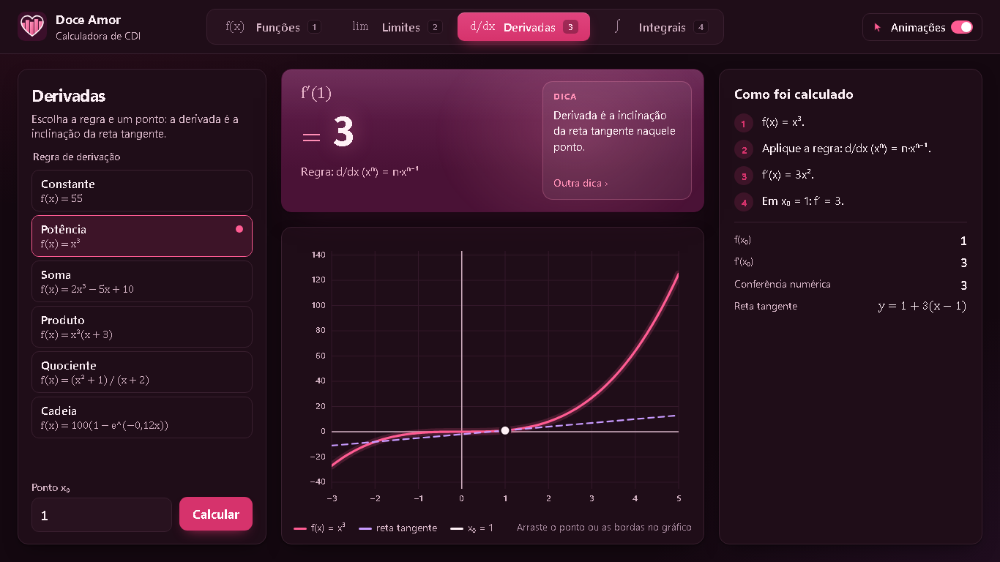

# LoveCalc

Calculadora didática de **Cálculo Diferencial e Integral**, com tema "Doce Amor". Projeto do 1º período de
Engenharia de Software.



## Estrutura

| Pasta | O que é | Situação |
|---|---|---|
| [`frontend/`](frontend/) | A calculadora: HTML, CSS e JavaScript puros, com testes | ✅ pronta |
| [`backend/`](backend/) | API que vai fazer as contas | ⏳ ainda não existe; o contrato da API está no README da pasta |

Enquanto o back-end não existe, o front-end calcula tudo localmente (`frontend/js/math.js`) e funciona sozinho.

## Rodar o front-end

```bash
cd frontend
python -m http.server 4173   # depois abra http://localhost:4173
npm test                     # 20 testes
```

## Módulos

- **Funções**: constante, afim, quadrática, modular e exponencial, com domínio, imagem, tabela e gráfico.
- **Limites**: removível (0/0), lateral que não existe e no infinito, com tabela de aproximação.
- **Derivadas**: constante, potência, soma, produto, quociente e cadeia, com reta tangente e conferência numérica.
- **Integrais**: cinco regras de primitiva e uma integral definida, com área no gráfico e conferência por Simpson.

## Licença

[MIT](LICENSE). O Three.js incluído em `frontend/vendor/` também é MIT (licença na mesma pasta).
