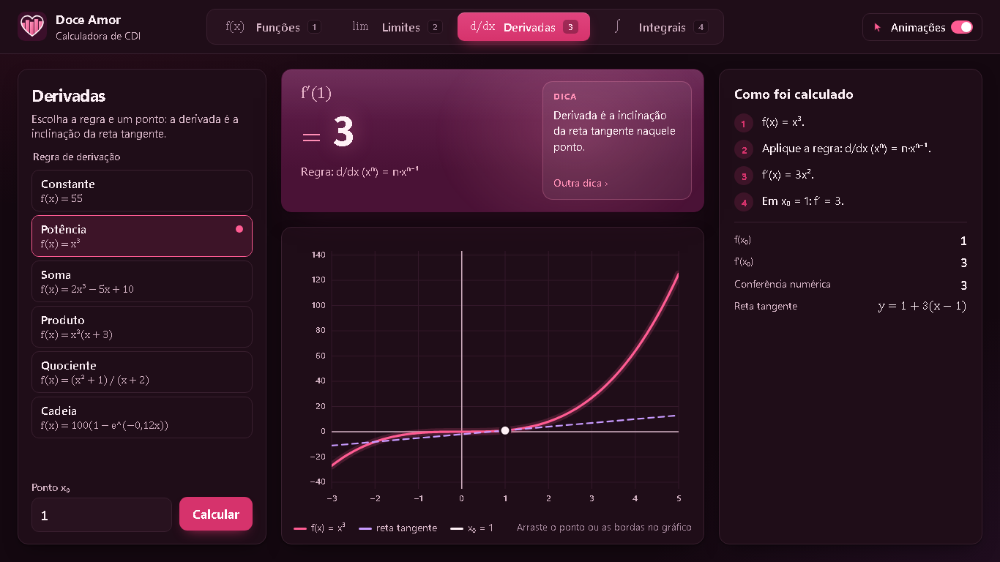

# LoveCalc — front-end

Calculadora didática de Cálculo Diferencial e Integral, numa tela só com quatro abas: **Funções**, **Limites**,
**Derivadas** e **Integrais**. Feita em HTML, CSS e JavaScript puros, sem dependências e sem internet
(o Three.js dos cursores animados fica copiado em `vendor/`).



## Como rodar

Os módulos JavaScript precisam de um servidor local (abrir o `index.html` direto não funciona):

```bash
cd frontend
python -m http.server 4173
```

Depois acesse `http://localhost:4173`.

## Testes

```bash
cd frontend
npm test
```

São 20 testes (`node --test`): contas de `math.js`, desenho do gráfico e trajetórias dos cursores.

## O que tem na tela

- **Controles** (esquerda): escolha do tipo, da regra ou do caso, e os valores de entrada, com validação.
- **Visor**: expressão, resultado e explicação curta. No canto, uma **dica** do assunto da aba ("Outra dica ›" troca).
- **Gráfico**: plano cartesiano próprio em canvas, com tangente, área, buraco e as cenas didáticas
  (pontos se aproximando no limite, secante virando tangente, retângulos de Riemann). Dá para arrastar o ponto e as bordas.
- **Como foi calculado** (direita): passos, valores e conferência numérica.
- **Animações**: setas que montam a tela ao trocar de aba. O botão "Animações" liga e desliga tudo.
- Atalhos: teclas 1–4 trocam de aba.

## Estrutura

```
index.html             tela única (abas, controles, visor, gráfico, detalhes)
styles.css             tema escuro "Doce Amor" (cores nomeadas no :root)
js/app.js              interface: abas, validação, visor, gráfico, dicas
js/math.js             contas (puras, sem DOM) — o back-end vai substituir por chamadas à API
js/graph.js            desenho do plano cartesiano (canvas 2D)
js/dicas.js            dicas de cada aba
js/cursor-*.js         cursores animados (Three.js)
assets/marca/          logo e símbolo em SVG
docs/                  guia de identidade visual e imagem de prévia
tests/                 testes com node --test
```

## Identidade visual

O símbolo é um coração preenchido pelas barras de uma soma de Riemann. Logo, cores, tipografia e regras de uso
estão em [`docs/identidade-visual.html`](docs/identidade-visual.html) (abra pelo servidor local).

## Integração com o back-end

Hoje as contas rodam em `js/math.js`. O contrato da API que o back-end vai implementar está em
[`../backend/README.md`](../backend/README.md), junto com o passo a passo para trocar as chamadas locais por `fetch`.
